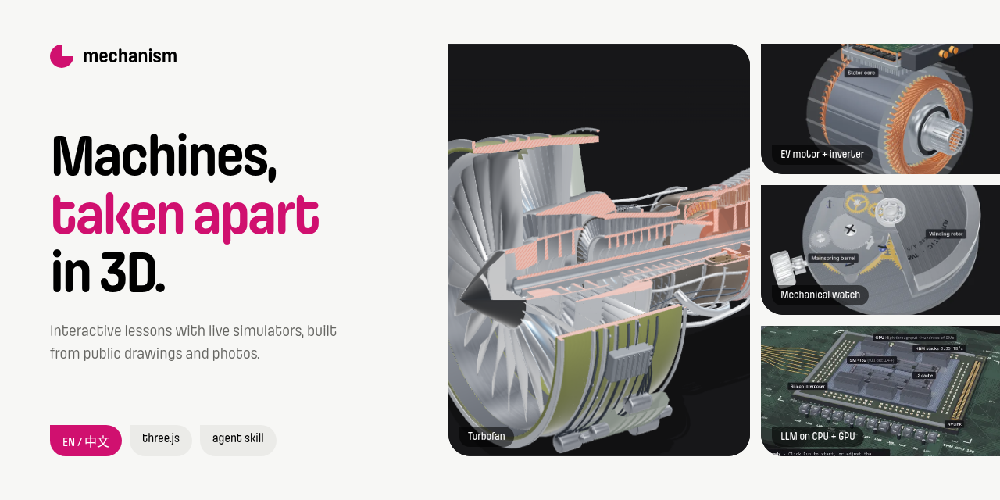
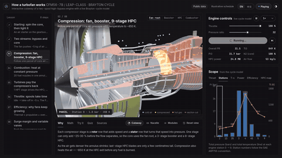
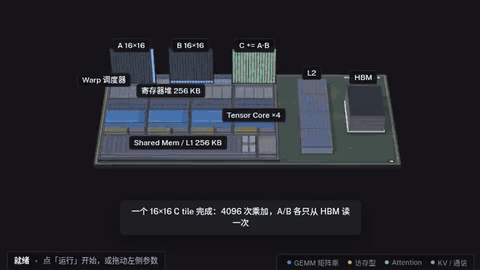
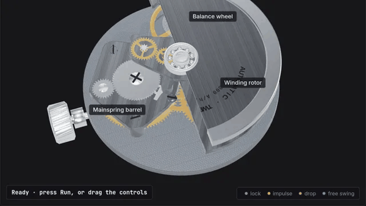
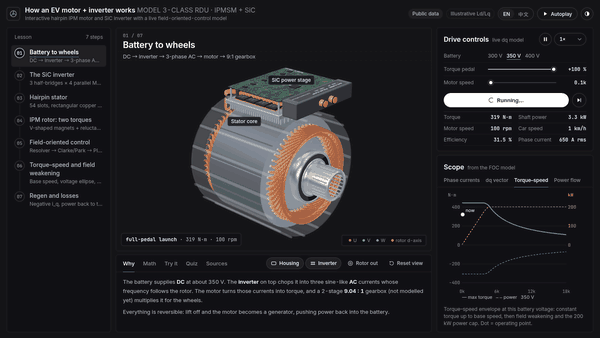

<p align="center"></p>

<h1 align="center">mechanism-explainer</h1>

<p align="center">
  <b>Interactive 3D lessons that take real machines apart, and the agent skill that builds them.</b><br>
  English · 中文
</p>

<p align="center">
  <a href="https://tyyy-z.github.io/mechanism-explainer/"></a>
  <a href="LICENSE"></a>
  
  
  
  <a href="skill/SKILL.md"></a>
</p>

---

## The lessons

| | Lesson | What you can do |
|---|---|---|
|  | **[How a turbofan works](https://tyyy-z.github.io/mechanism-explainer/explainers/turbofan/)**<br>CFM56-7B-class two-spool high-bypass engine, 8 steps | Start the engine, then throttle it, light the combustor and push the compressor into surge. A live Brayton-cycle model drives the spools, temperatures and thrust. |
|  | **[One LLM token on CPU + GPU](https://tyyy-z.github.io/mechanism-explainer/explainers/llm-compute/)**<br>From the CPU core to HBM stacks and the KV cache, 9 steps | Run prefill and decode, and see where the roofline caps you. Watch KV-cache pages fill the HBM stacks. |
|  | **[How a mechanical watch works](https://tyyy-z.github.io/mechanism-explainer/explainers/watch-movement/)**<br>ETA 2824 / NH35-class automatic movement, 7 steps | Wind the mainspring, follow the gear train to the Swiss lever escapement, change the beat rate and watch the timegrapher trace drift as the power reserve runs down. |
|  | **[How an EV motor + inverter works](https://tyyy-z.github.io/mechanism-explainer/explainers/ev-motor/)**<br>Model 3-class rear drive unit: hairpin IPM motor, SiC inverter, 7 steps | Push the pedal and sweep the speed: a live field-oriented-control (dq) model moves the current vector, shows the voltage-limit ellipse closing in (field weakening), draws the torque–speed envelope and flips power flow into regen. |

Every lesson:
- is **one self-contained `index.html`**, with three.js and fonts from a CDN and no build tools;
- models **real parts from public drawings and photos**, not placeholder shapes. Each one is checked side by side against reference photos (see `explainers/*/fidelity/REVIEW.md`);
- runs a **linked simulator**, so changing a control changes the 3D scene, the readouts and the charts together;
- is **bilingual**: English by default, with 中文 from the toggle or `?lang=zh` (remembered in localStorage);
- supports **deep links**: `?step=3` opens a given step, and `?quality=low` suits weak GPUs.

## Run locally

```bash
git clone https://github.com/tyyy-z/mechanism-explainer
cd mechanism-explainer
python3 -m http.server 8000      # then open http://localhost:8000
```

Each lesson can also be opened straight from disk (`explainers/<slug>/index.html`).

## Rebuild a lesson

Sources are in `explainers/<slug>/src/`. `build.py` inlines them into `index.html`:

```bash
cd explainers/turbofan && python3 build.py
```

## Layout

```
index.html              hub (English default, 中文 toggle)
assets/                 hub css/js, posters, preview loops, step thumbnails, photos
explainers/<slug>/      index.html · build.py · src/ · refs/REFS.md · fidelity/REVIEW.md + *_sbs.webp
skill/SKILL.md          the agent skill that builds these (install: skill/README.md)
docs/                   README banner and GIFs
```

## The skill

[`skill/SKILL.md`](skill/SKILL.md) is the agent skill behind these lessons, covering:
- concept lessons;
- rebuilding a reference video as a live 3D app;
- deep device lessons from public sources;
- the real-device fidelity standard;
- bilingual UI;
- packaging lessons into a hub like this one.

Install notes are in [`skill/README.md`](skill/README.md).

## Sources and credits

- All technical content comes from **public sources only**. Each lesson cites them in `refs/REFS.md`. Values are typical or illustrative, not measurements of any specific product.
- Hub photos are from Wikimedia Commons, with credits in the site footer:
  - Honeywell HTF7000 by Matti Blume
  - MF30011R die and Intel i486DX2 by Mister rf
  - jet engine at the Košice aviation museum by ZemplinTemplar

  All are CC BY-SA 4.0.
- Lesson reference photos (Wikimedia Commons, used for the side-by-side fidelity sheets; full table in each `refs/REFS.md`):
  - **Watch movement:** ETA-2824-A2 (de.wikipedia user, CC BY-SA 3.0); Stowa Antea ETA 2824 macro by Guy Sie (CC BY-SA 2.0); ETA 2801 movement and lever escapement by Micky Aldridge (CC BY 2.0); ETA-2824 in a Longines and ETA close-up by KRaikkonen01 (CC BY-SA 4.0); Chinese movement escapement/jewels and balance wheel by Hustvedt (CC BY-SA 3.0); Benrus balance wheel by Chris Burks and Seiko 7S26 movement by "Poor Man watch" (public domain).
  - **EV motor + inverter:** Hairpin-Stator and Hairpin-Stator Aufbau by PEM RWTH Aachen; IGBT module by Sthdhk; uncased film capacitor by Phiarc; VT-5 resolver by Padonak39 (all CC BY-SA 4.0).
- Reference images in `explainers/*/refs/` and the side-by-side sheets keep their original licences (CC BY-SA / CC BY / CC0 / public domain), as listed in each `REFS.md`.
- Code is MIT licensed © 2026 tyyy-z.
